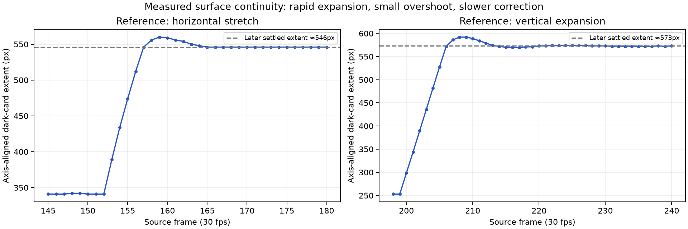

# Frame-rate motion study and Apple revision

Both supplied references were decoded without frame resampling and reviewed in consecutive-frame contact sheets. Reference 1: 267 frames, 1276×718, 30 fps, 8.9 seconds. Reference 2: 379 frames, 720×720, 30 fps, 12.633 seconds. Frame numbers below are zero-based. All 646 frames were reviewed; larger originals remain available for close inspection. No source footage, soundtrack, widget interface, or third-party design is embedded in the Apple revision.

## What the references actually do

| Reference / frames | Observed behavior | Why it works | Application |
|---|---|---|---|
| 1 / 39–60 (1.30–2.00 s) | The central brand lockup yields to a circular selection; neighboring circles enter after it. The atmospheric field stays continuous. | One attention anchor survives while the next context builds around it. | Keep the product stage alive across chapter boundaries; delay detail layers. |
| 1 / 96–132 (3.20–4.40 s) | Intro copy and a playlist travel upward through the same visual space; later rows trail rather than move as a rigid screenshot. | Direction and stagger imply one continuous system instead of two replaced slides. | The product leads; supporting type follows by about 0.10–0.15 s. |
| 2 / 24–47 (0.80–1.57 s) | Cards assemble around the brand; the central mark remains readable while the field moves. | A stable focal point makes extensive surrounding movement easy to track. | Stable stage center and stable headline margin, never multiple competing hero actions. |
| 2 / 80–111 (2.67–3.70 s) | The word becomes a compact pill, the mark becomes a red point, and that point travels toward the emerging activity surface. | Shape and position carry identity; the next scene grows from the previous one. | Reuse a single clipped surface instead of introducing a full-frame wipe. |
| 2 / 145–180 (4.83–6.00 s) | The square activity surface shifts slightly, stretches horizontally, briefly exceeds its final width, then settles. Internal charts arrive during the stretch. | Fast main travel, slight overshoot and a slower landing convey weight; delayed content prevents everything landing at once. | Anticipation 0.10–0.13 s, main deformation about 0.30 s, settle 0.27–0.35 s; content offset0.10 s. |
| 2 / 190–214 (6.33–7.13 s) | A shallow card lifts, expands vertically and changes content while retaining its outer surface. | Container continuity makes a substantial content change legible. | Move from detail to pair while deforming the same stage; change content during peak geometric motion. |
| 2 / 250–280 (8.33–9.33 s) | The large card first leans/grows, then rapidly rotates and contracts; a smaller card overshoots and settles at center. | Preparation gives the contraction a cause; follow-through avoids a dead stop. | Before the listener-to-case transition, preload with a small expansion/tilt, then contract and settle. |
| 2 / 291–348 (9.70–11.60 s) | The final card recedes, short typography resolves, then the mark holds. | A restrained ending provides a reading and recognition interval after energetic movement. | Final product and Apple lockup hold after the last settle. |

## Measurements, not guessed easing names

A dark, low-saturation connected-component mask tracks the activity card's outer bounding box in reference2. It is approximate: antialiasing, perspective and internal content affect the estimate; these are not source keyframes or a recovered spring equation.

- f145: about341×340px; f153:389×322px; f156:512×270px; f159:560×246px; f168:546×255px. The width peaks about2.6% above the later546px width. The major stretch occurs over roughly10–15 source frames, with a smaller correction afterward.
- f198:546×253px; f202:546×390px; f206:546×572px; f208:546×592px; f240:546×573px. The vertical expansion preserves width, with about3.3% bounding-height overshoot before settlement.
- f250–266 includes rotation: axis-aligned boxes cannot distinguish scale from rotation. Visually the card preloads before contracting; the dimensions alone are not a reliable scale curve.

## Why v2 missed it

V2 held completed posters, then translated whole compositions vertically. That created traveling page edges, separate element identities and one common velocity for all content. Slowing a page wipe or selecting a different ease does not create the shape/attention continuity in the references. Its correct layer order and passing layout checks established technical behavior, not convincing motion.

## V3 implementation

One native, editable persistent-stage composition owns a single rounded clipping surface through the entire20seconds. The shell/cutaway share an aligned source silhouette. The stage widens for detail, reforms for the pair, opens into the listener image and contracts into the final case. Main deformations use explicit peak and settle states; small preparation and delayed content provide successive motion beats. The surrounding copy changes after the lead motion begins. Product art, copy, aspect ratio, music and no-voiceover constraint stay within the existing Apple concept. Native timeline frame rate60fps; reference-derived durations expressed as whole output-frame counts where possible. This adapts the reference's principles rather than reproducing its widgets or claiming to recover its original animation curves.

## Refinement after frame inspection

Initial crossfades of dissimilar product images produced double exposures. Replaced with a narrow-face handoff inside the persistent surface. For the listener transition, the two real earbuds are separated from the same source alpha artwork: one exits and the other reduces toward the photographed ear. The listener-to-case transition closes the image before the case opens; the exterior surface remains continuous. The original source pixels are preserved.

## Export-level correction

The first60fps export exposed a CSS inset-shorthand interpolation fault: browser-normalized clip-path values caused an off-center rectangle for a few frames. The final project animates each inset and radius as its own numeric CSS custom property, preserving center and corner continuity. Consecutive output frames, not a midpoint screenshot, revealed this issue. The corrected export is reviewed across all292 frames in the four transition windows.

## Final encoded verification

Reviewed all292 consecutive60fps frames across the four transition windows. T1 measured peak width902px, settled width880px: 2.5% overshoot. The first two motion frames retain a554px width instead of jumping; all tested corners remain rounded. Full export:20seconds,1080×1080,60fps,1200frames,H264/AAC; no flat frames or clipped audio samples. Native checks:zero errors or warnings. These are technical and motion-continuity checks, not a claim of subjective equivalence to the references.
